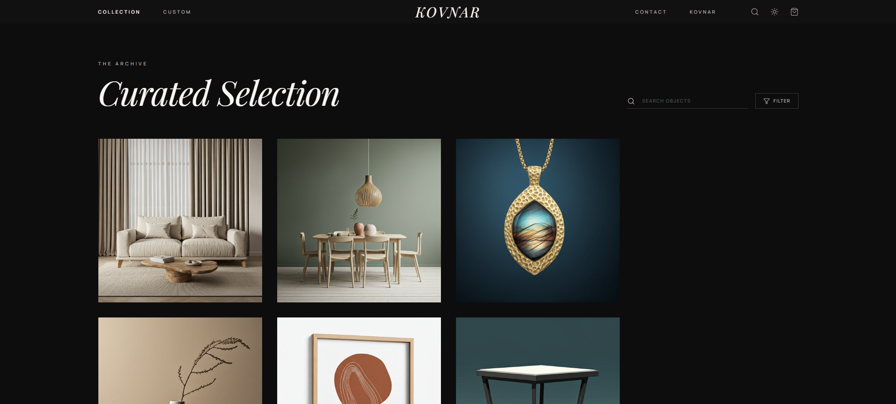
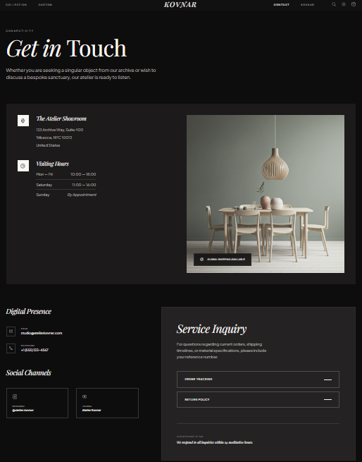
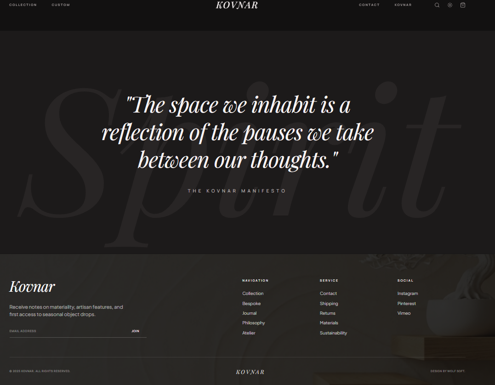

<p align="center">
  
  
</p>

<h1 align="center">Atelier Kovnar</h1>
<p align="center">A considered digital storefront for furniture, lighting, and home objects.</p>

<p align="center">
  
  
  
  
</p>

---

## Overview

Atelier Kovnar presents a curated collection of furniture, lighting, and decor through an editorial-style shopping experience. Visitors can browse products, view details, manage a cart, and explore bespoke commissions and studio information.

| Section | What it offers |
| :--- | :--- |
| **Home** | Studio introduction, philosophy, and featured pieces |
| **Collection** | Browse the product catalog |
| **Product details** | View an object's description, materials, and price |
| **Cart and checkout** | Review selected products and adjust quantities |
| **Bespoke** | Explore options for a custom commission |
| **Studio information** | Materials, sustainability, contact, shipping, and returns |

## Features

- Product catalog with categories, descriptions, material details, and imagery.
- Individual product pages and a cart drawer with quantity controls.
- Checkout page for reviewing the cart.
- Bespoke commission interface with object, material, finish, dimension, and budget options.
- Studio pages for contact, materials, sustainability, shipping, and returns.
- Optional client-side product catalog editing, saved in the browser's `localStorage`.
- Responsive layouts and animated transitions.

> **Demo access:** the studio passcodes (`kovnar` and `admin`) are checked in client-side code. They are for demonstration only and do not provide secure authentication. Catalog edits are stored in the current browser and are not shared across devices.

## Project Gallery

Screenshots of the application:

### Landing page
<p align="center">
  
</p>

### Collection
<p align="center">
  
</p>

### Bag option
<p align="center">
  
</p>

### Delivery progress
<p align="center">
  
</p>

### Contact
<p align="center">
  
</p>

### Bottom section
<p align="center">
  
</p>

## Technology

| Area | Tools |
| :--- | :--- |
| **Frontend** | React 19, TypeScript |
| **Development and build** | Vite 6 |
| **Styling** | Tailwind CSS 4 |
| **Routing** | React Router 7 |
| **Animation** | Motion |
| **Icons** | Lucide React |

## Getting Started

### Prerequisites

- [Node.js](https://nodejs.org/)
- npm

### Install dependencies

```bash
npm install
```

### Start the development server

```bash
npm run dev
```

Open [http://localhost:3000](http://localhost:3000) in your browser.

## Available Scripts

| Command | Description |
| :--- | :--- |
| `npm run dev` | Start the development server on port 3000 |
| `npm run build` | Create the production build in `dist/` |
| `npm run preview` | Preview the production build locally |
| `npm run lint` | Check the TypeScript project with `tsc --noEmit` |
| `npm run clean` | Remove the local production build output |

## Project Structure

```text
kovnar/
├── picture/                  # Screenshots shown in the Project Gallery
├── src/
│   ├── components/           # Shared navigation, product, cart, and studio components
│   ├── lib/                  # Product data and cart/admin state
│   ├── pages/                # Collection, product, checkout, and studio pages
│   ├── App.tsx               # Application routes and shared layout
│   ├── index.css             # Global styles and Tailwind entry
│   └── main.tsx              # React entry point
├── index.html
├── package.json
├── tsconfig.json
└── vite.config.ts
```
